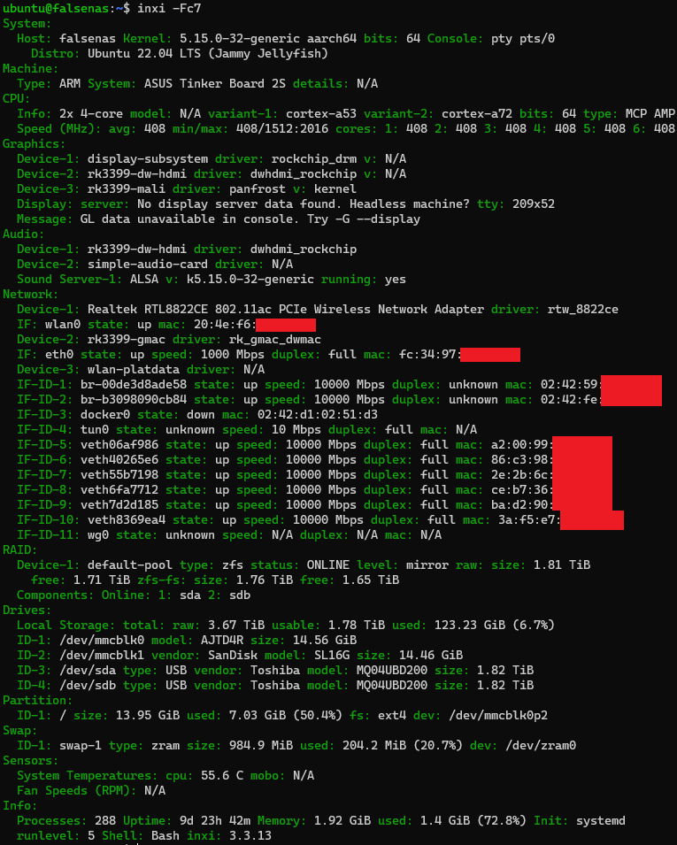

## 前言/屁話

上一次寫blog已經是在一年多前了，這裡真的是放到快長草了  
沒拉，我沒有忘記這裡，伺服器如果是託管或GH我可能真的真的就不管了，但這可是在我樹梅派2上運作的怎麼可能忘記

對!說到伺服器(強硬點題)，原本買了一塊ASUS Tinker Board 2S，本來想做為一些軟體無線電應用之類的，但官方的Debian系統有點一言難盡，apt 預設source都在國外，下載速度實在是對不起家裡剛換的1G路由器

如果換source吧，會缺少特定軟體支援，而且官方系統的kernel版本最高就到4.9(沒記錯的話)，那如果有這麼多問題為甚麼我不自己重新自己編譯一份系統呢?

所以這篇文是在描述我折磨我自己全過程

## 準備交叉編譯環境(cross-compile)

總而言之你只需要一個能夠編譯arm64的編譯器，我是直接在WSL 1上面設定的，可以參考其他人設定arm64交叉編譯環境

## 編譯U-Boot

萬事起頭難，開機也是從bootloader開始(硬扯)，甚麼?你說其實是先從boot rom開始?，不重要啦，我又不是這個嵌入式系統專業的，而且我也不需要從boot rom編譯，等等我也不會編譯U-boot...

先看官方怎麼做的吧，從[官方github](https://bit.ly/3GSgtAf)找來u-boot原始碼，照著做總沒錯了，後來我用U-Boot官方v2022.04版本的source當最終版本，原本是用v2021.10，但不知道為甚麼沒辦法從EMMC開機，試到快瘋了才想到換版本

TK2S 的 CPU 是 RK3399 開機提供[兩種模式](https://bit.ly/3NR6E88)，一種是使用官方的初始化程式(閉源)，另一種是U-boot的TPL/SPL

既然都選擇開源了，那肯定是用第二種，編譯的時候需要config 和 device tree，config用官方的就可以了，記得打開lpddr4支援還有選對板子(預設是chromebook)，如果有額外需要設定一些記憶體位址，參考rk3399-evb的config，device tree的部分，一樣用rk3399-evb的dts，但需要修改一下引用的記憶體類型，rk3399-evb用的是lpddr3，註解掉改引用lpddr4的版本

編譯完成後得到 idbloader.img 和 u-boot.img ，分別燒到0x40和0x4000

阿對了記得編譯ATF(bl31.elf)，希望現在說還來的及(被揍

## 編譯 Linux Kernel

最最最最折磨人的時刻終於到了，先從device tree開始

device tree用於描述硬體訊息的方法，但RK3399的BSP kernel的device tree一部分並不相容 linux mainline，所以悲傷的事情來了，我需要從頭一個一個檢視這兩邊的差異從頭寫一份device tree

你是不是以為這就結束了?天真! fan53200是TK2S的voltage regulator，但是這個驅動並不存在 mainline 中，所以我也得自己修改相關驅動

你是不是又以為這就結束了?太天真了! TK2S上的乙太網路的MAC address是從I2C通道上的一片EPROM提供，然後mainline 中一樣沒有相關方法，所以也得自己改，不過我在這裡發了個懶，我直接在檢查MAC有效時直接寫死MAC，原諒我...

最後是config，按照ubuntu 基本需求去選就好了

編譯完成得到 dtb 和 kernel，放進boot分區，建立 extlinux/extlinux.conf 開機選單，最後從ubuntu那複製一份 meta-data, network-config, user-data 進來，分區label用system-boot，類別fat32

## 系統

理論上來說，我應該從ubuntu官方的base製作一份rootfs，但既然Rpi 4也是64位元的，所以我直接從for Rpi 4的image用dd貼過去

## 後記

到這裡，我有了一個能開機的，沒有其他功能(kernel module)的ubuntu

所以後來又用ubuntu的kernel source編譯了一遍，這邊坑也是蠻多，比方說編譯環境要求更高，initramfs沒辦法開機等，不過有zfs, wireguard等功能這些努力挺值得的

最後貼一下inxi證明:

最後把自己生的垃圾丟出來給大家圍觀，至於系統和其他二進制文件，就不丟出來丟人現眼了，畢竟問題還蠻多的

[https://gist.github.com/Benny1923/a6e28f2406f305b7144c4d67908657aa](https://gist.github.com/Benny1923/a6e28f2406f305b7144c4d67908657aa)

沒有問題的部分

*   可以開機
*   乙太網路介面
*   USB 3 type A 介面(type C 沒有條件測試)
*   三顆LED(pwr, act, rsv，act 動作燈很暗，不清楚為甚麼)

有問題的部分

*   藍芽
*   HDMI(沒有測試)
*   其他沒提到的介面
*   sdio 電壓報錯(沒有影響)

目前是先用第一版的kernel進系統後用安裝自己編譯的ubuntu kernel替代，原本的當作備用開機替代

## 結論

我再也再也不要使用社群小的板子了...

\# 2025-03-11 更新: 官方的debian kernel 已經到 5.10.198 可以不用自己找自己麻煩了, 開心~