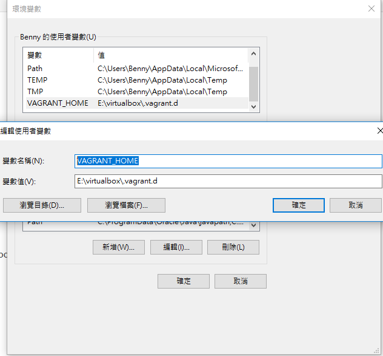
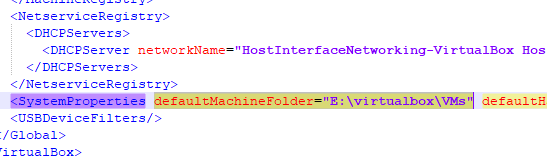
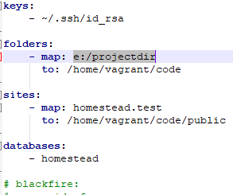

身為一名苦逼的高中生，有時候被學校一些奇怪的文件格式和閱讀程式所以被windows綁住也是理所當然的(WTF
最近換了SSD，開機速度真的沒話說
換了SSD帶來的不一定只有好處

> 使命：盡量不要把它填滿 -- Benny @ 2018

從前有個小男孩，他安裝程式就是下一步同意下一步到底
換了SSD後他需要仔細地看完每一步，並更改安裝位置到HDD
不得不說，SSD的容量真的很令我傷腦筋...
這還不打緊，SSD有明確的壽命問題，任何重要的資料放在SSD都不OK
最近在使用laravel開發網站
對，在windows上
想必得用到虛擬機之類的，但虛擬機真的超傷SSD(看那驚人的讀寫率)
照著官方的說明安裝虛擬機，發現他是裝在C碟的使用者資料夾下
搞什麼，我還不想那麼早讓SSD折壽
於是在網路上東找西找終於找到了類似的文章(感嘆google讚嘆google)
先說明我的環境 virtualbox 5.2.8 vagrant 2.0.3 在 windows 10 (build 1709) 全部都是64位元
不一定要用上面版本
那麼先把目標路徑的資料夾建好
然後執行
`SystemPropertiesAdvanced.exe`
打開「環境變數」
然後在使用者變數中新增一筆變數，叫「`VAGRANT_HOME`」，變數值輸入目的路徑加上「`.vargrant.d`」
好了確定保存

大概像這樣吧
然後去修改
`C:\Users\[使用者名稱]\.VirtualBox\VirtualBox.xml`
找到 `defaultMachineFolder`，並把他的值修改成目標資料夾

改完後你就可以開心地使用vagrant下載box和安裝box不用擔心容量和SSD被操死的問題了
嗯?你問我怎麼把laravel的專案移動到其他地方?
知道homestead.yaml吧?這麼做就好啦

以上內容參考自
[https://medium.com/@cedricdue/moving-vagrant-boxes-and-related-virtualbox-vms-to-another-drive-f1d7c50d20bc](https://medium.com/@cedricdue/moving-vagrant-boxes-and-related-virtualbox-vms-to-another-drive-f1d7c50d20bc)