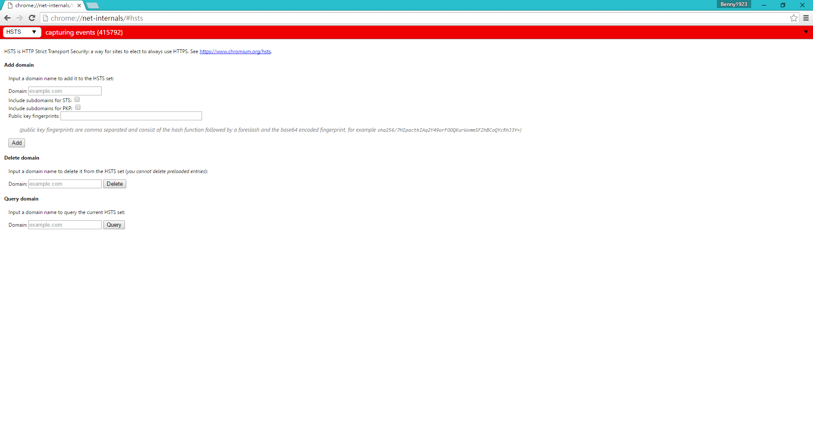
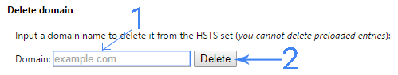
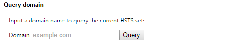
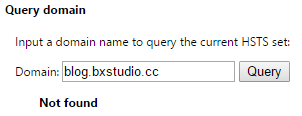
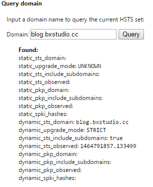

最近在幫工作室製作新網頁和伺服器歲修(弄丟了張SD卡，超傷心，我的資料啊)及其他的雜事，都沒麼時間在這blog上面，在此先致上87分的歉意，不能再高了(眾:打他
不鬧了，進入正文吧 HSTS簡介:HSTS全名是HTTP Strict Transport Security 中文名「強制安全傳輸技術」，原理是在第一次訪問https網站時，網站的回覆表頭帶有「Strict-Transport-Security」，該表頭會讓瀏覽器記得，該網站(正確說法是域名)有提供HTTPS安全連線，並於下次連線中強制使用HTTPS，注意是強制喔，不論是點進不帶有https的連結(例如:[這個](http://blog.bennyling.cc/362/))，或是你故意在網址列打入網址時使用http://為開頭，瀏覽器都會先強制轉換成https再送出請求
當然這些規則是建立在「該瀏覽器曾經訪問過該網站(域名)，並在https網頁中留下「Strict-Transport-Security」這個表頭，並且再次訪問該網站的間隔時間必在「Strict-Transport-Security」中的「max-age=時間」的有效值內(單位是秒數，多數人設定是兩年也就是「max-age=31536000」)才會被瀏覽器強制轉換成https。啊啊啊我不會解釋拉，去看維基百科解釋或許會比較好，[傳送門按我](http://bit.ly/1ZcSnmQ)(謎之聲:你不早點貼，害我看了堆廢話
那麼問題來了!Benny在自己的網站設定了https和HSTS(max-age是兩年)後用chrome訪問了自己的網站，但又反悔把https關掉，再使用chrome訪問自己的網站(一切都發生在2小時內)，請問:

會發生什麼事呢?
答案:Benny的chrome會因為HSTS設定，在瀏覽自己網站時，強制被轉換成https，但又因為該網站已經不再提供https連線進而連線失敗
那怎麼辦呢?
當然我今天是來說解決方法的，解決的方法就是:
~~等兩年後HSTS失效再訪問網站~~
手動(強制)讓HSTS失效，當然這就是本篇的主題
流程:
首先在Google Chrome的網址列輸入 chrome://net-internals/#hsts
接下來按Enter
你就會看到以下的畫面:

在Delete domain區域中的文字格輸入你要清除HSTS設定的域名(1)，然後按「Delete」(2)

按完之後，啥事都不會發生，所以要確認下有沒有成功刪除HSTS

在下方Query domain的區域中的文字格輸入你剛剛刪除的域名，然後按「Query」

成功刪除的話應該會像下圖情況，下方出現Not found的提示

失敗的話如下圖，瀏覽器會回報關於該域名HSTS的資訊

個人小註解時間:
在刪除子域名的HSTS的時候，建議把根域名也輸入，例如:要刪除 blog.bxstudio.cc，就要把bxstudio.cc 和 blog.bxstudio.cc 分別給Delete domain來刪除，原因是什麼，本人目前還不清楚，有空再研究吧
還有啊，我發現Vivaldi也可以用這方法清除
其他瀏覽器如firefox和opera....清除HSTS的方法還在研究，等哪天知道再更新吧