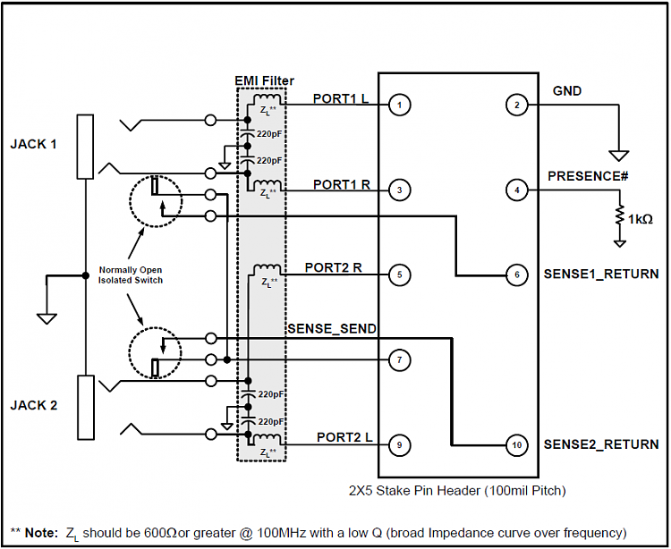

電腦前面板的音效輸出插座壞惹  
這種跟機殼在一起成套的零件似乎是沒有在替換的

不然...自己試著修理看看?  
先去買零件，麥克風的插座其實跟耳機是一樣的  
然後回去拆了機殼上的插座，簡單記錄下腳位和對應的線路  
然後悲劇了

買錯插座，少兩隻開關腳位  
機殼上的音訊插座有個開關腳位  
用來判斷耳機換是否插入

然後我買的插座沒有開關  
怎麼辦呢?  
那來研究一下腳位好了

這是HD audio前面板音效接腳  
若7腳與6或10短路，晶片就會認為前面板有插入麥克風或是耳機  
我的插座就是因為這裡壞了(接觸不良)才沒聲音

於是乎我索性直接把6,7,10直接銲接在一起  
缺點就是電腦會一直認為前面板有麥克風耳機  
只能手動切換輸出裝置  
(沒差，反正我只用耳機)

圖片來源: [https://www.sevenforums.com/sound-audio/44491-ac97-hd-audio-front-panel-layouts.html](https://www.sevenforums.com/sound-audio/44491-ac97-hd-audio-front-panel-layouts.html)