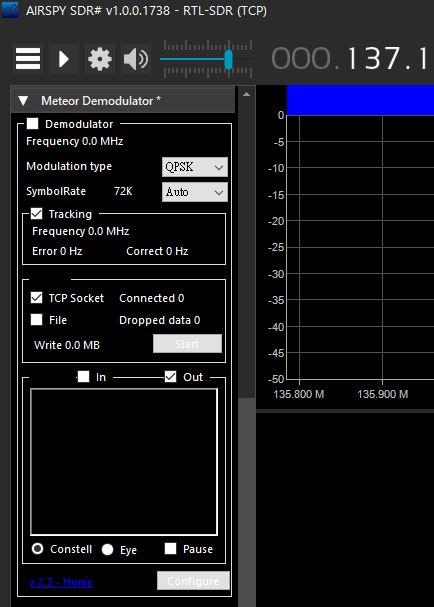

somehow  
I download meteor plugin from rtl-sdr.ru  
and install it…

It's not working as I expected, it didn't shows on the plugin panel, then I close sdrsharp, .NET error message pop up, it happened at :  
SDRSharp.Meteor.MeteorPlugin.Close()

I tried google, but nothing.

So I decided decompile the plugin and try to fix it.  
and I did it.

meteor plugin v2.3 on SDR# 1738

There is download link:  
[modded version](http://bit.ly/37U05iT) <-- bug fixed, download this one  
[Original Post(rtl-sdr.ru)](http://bit.ly/3hvPIFm) <-- before bug fix
