接續上篇硬體篇，東西都買好後就可以著手設定拉  
這篇使用作業系統Windows 10，軟體用SDR#，初學用這個也方便

這裡放連結：  
[SDR#(SDRsharp)](https://bit.ly/2ZwQ8U2)

下載完後解壓縮到桌面還是哪裡  
打開資料夾找到install-rtlsdr.bat  
然後點兩下安裝

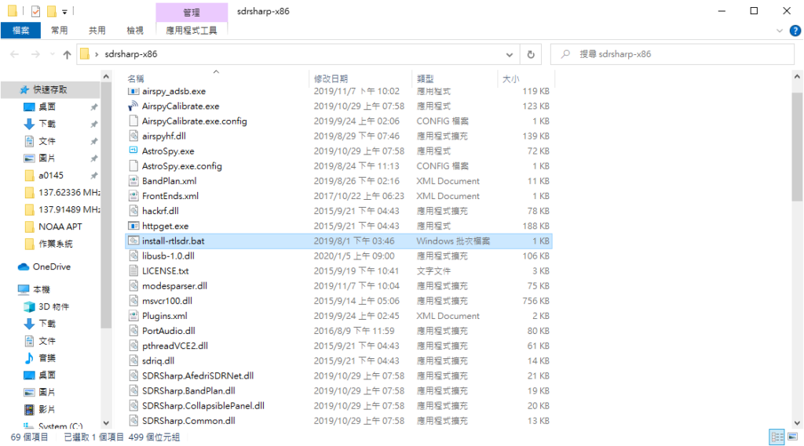

接下來注意!  
如果你用的是win7可以忽略下面操作(關閉驅動強制簽章部分)

## 關閉驅動強制簽章

win10有強制驅動簽章，要先關掉才能裝驅動  
方法也很簡單，按著SHIFT不放，然後點重新開機  
進入重啟選單然後照著下列選項點  
「疑難排解」->「進階選項」->「啟動設定」->「重新啟動」(這邊會重開電腦)->鍵盤按數字7  
下面有圖

*   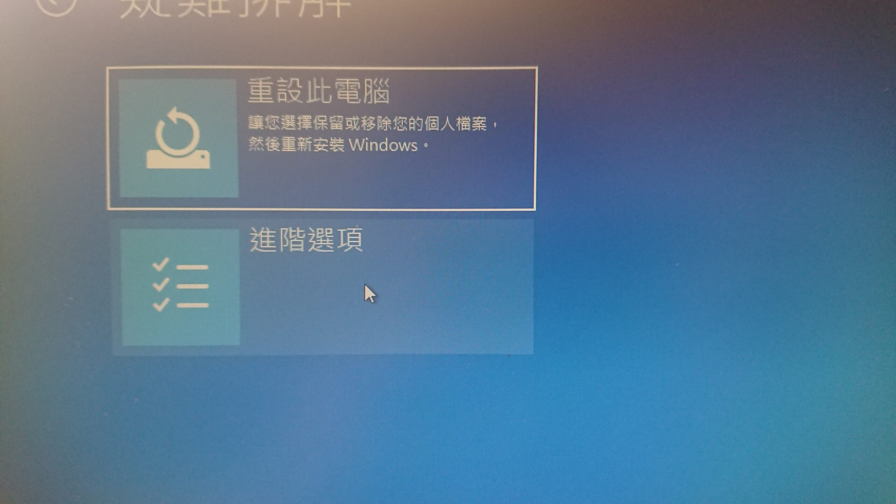
    
*   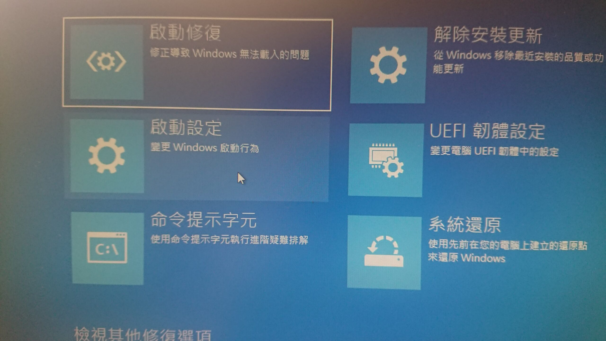
    
*   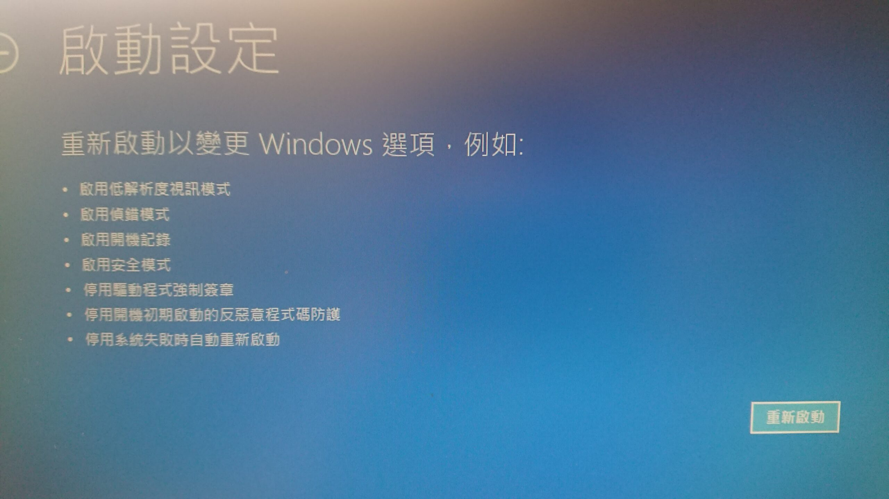
    
*   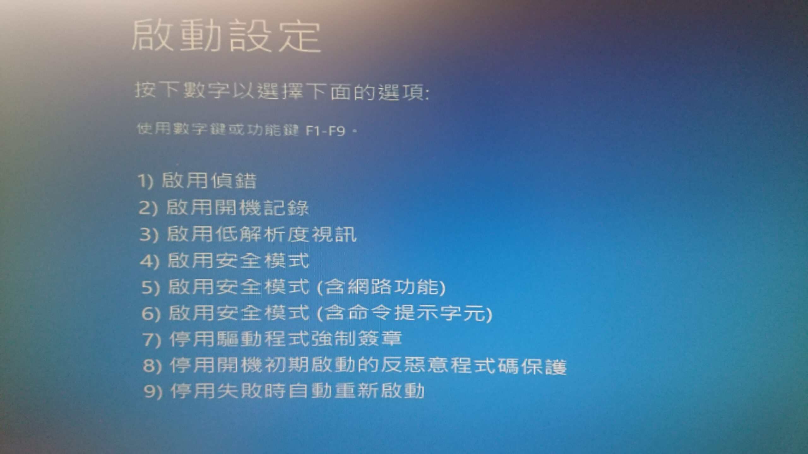
    

## 安裝驅動

插上電視棒  
在資料夾下找到並打開zadig.exe

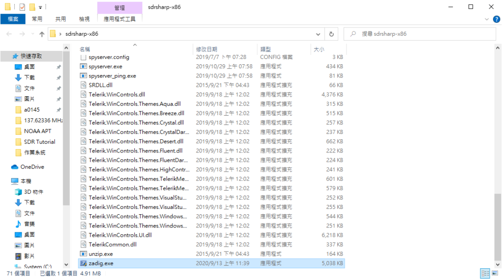

選「options」，把「List All Devices」打勾

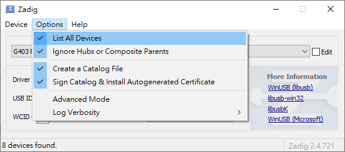

下面長條選單找到「Bulk-In, Interface (Interface 0)」  
確定一下USB ID 是 0BDA 2838然後按「Replace Driver」  
過程中可能有警告，按安裝就好

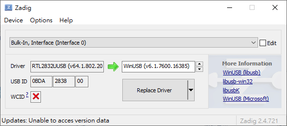

## 簡易操作教學

打開SDRsharp.exe，一個複雜的介面彈了出來

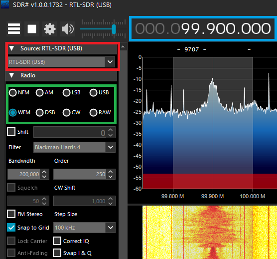

紅框：來源選擇  
綠框：訊號格式  
籃框：當前頻率

找到紅色框，找到並選擇「RTL-SDR (USB)」  
齒輪按一下把「Tuner AGC」打勾後按Close，齒輪旁的播放鍵按下去，就可以開始收聽了

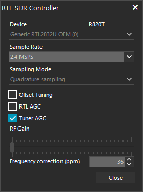

可以先試試看把頻率調到當地電台，訊號格式選WFM

## What's next?

SDR可以玩的東西很多的，最直接就是拿去收聽航空/業餘波段  
再者，你也可玩數位解碼，DSD Plus, TETRA了解一下  
(在這邊提醒一下，不要破解有加密的通訊，會犯法)

最後，暑假結束了，好不甘心  
覆蓋一張自己接收到的衛星照結束這回合

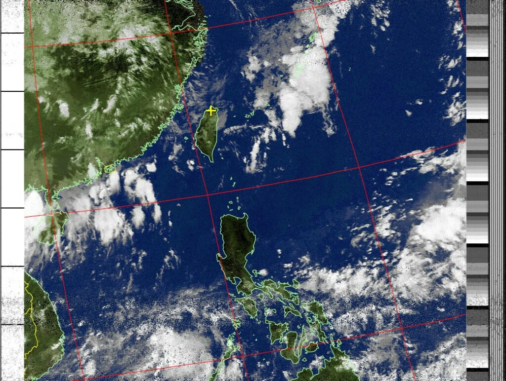