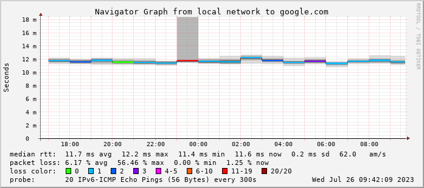

總感覺家裡網路怪怪的，用 docker 架設一個 smokeping 監視網路延遲

步驟如下:
1. 安裝docker
2. 設定ipv6
3. 寫docker-compose.yaml
4. smokeping, 啟動!

## 安裝 docker

這邊不使用發行版的 docker.io package，用官方的 repo, 之後可以用apt更新

[https://docs.docker.com/engine/install/debian/](https://docs.docker.com/engine/install/debian/)

## 設定ipv6

docker 預設不啟用 ipv6, 所以如果要讓 smokeping 能用 ping6, 這個步驟是必須的

還好, 設定並不難

新增並修改`/etc/docker/daemon.json`

內容如下:

```json
{
  "ipv6": true,
  "fixed-cidr-v6": "2001:db8:1::/64",
  "ip6tables": true,
  "experimental": true
}
```

預設 network `bridge` 使用 `fixed-cidr-v6` 配發位址, `ip6tables` 轉發流量
`ip6tables` 屬於實驗功能, 需要啟用`experimental`

## 寫 docker-compose.yaml

你完全可以用 `docker run`, 但我喜歡用compose管理container

```sh
mkdir smokeping
cd smokeping
touch docker-compose.yaml
```

編輯 `docker-compose.yaml`

```yaml
version: '3.9'
services:
  smokeping:
    image: lscr.io/linuxserver/smokeping:latest
    container_name: smokeping
    network_mode: bridge
    security_opt:
      - no-new-privileges:true
    environment:
      - PUID=1000
      - PGID=1000
      - TZ=Asia/Taipei
    volumes:
      - $PWD/config:/config
      - $PWD/data:/data
    ports:
      - 8003:80
    restart: unless-stopped
```

`/config`: smokeping 設定
`/data`: smokeping 的資料庫

修改 `ports` 的 8003 對應到你想要開放的通訊阜

### 設定 smokeping

```sh
docker compose up
```
等它初始化完成後 `ctrl + c`關閉

修改 `config/Targets`

找到類似這個區域

```
+ InternetSites

menu = Internet Sites
title = Internet Sites
probe = FPing

++ Facebook
menu = Facebook
title = Facebook
host = facebook.com

++ Youtube
menu = YouTube
title = YouTube
host = youtube.com

++ GoogleSearch
menu = Google
title = google.com
host = google.com
```

`+`用來標示目錄層級, 不允許名稱有空白, 這裡的名稱也會作為資料庫的索引

`probe`: **重要** 探針, 測試主機的方法, 定義在 `config/Probes` 中, 如果想測試ipv6, 使用 `FPing6` 取代 `FPing`

`menu`: 顯示在左邊目錄的名稱

`title`: 頁面標題

`host`: 測試主機

更詳細的說明可以在 [官方文件](https://oss.oetiker.ch/smokeping/doc/smokeping_config.en.html) 中找到

## smokeping, 啟動!

```sh
docker compose up -d
```

## 後記

網路是真的有問題... ipv6 掉包掉的很嚴重



## 參考:

docker ipv6 support: [https://docs.docker.com/config/daemon/ipv6/](https://docs.docker.com/config/daemon/ipv6/)